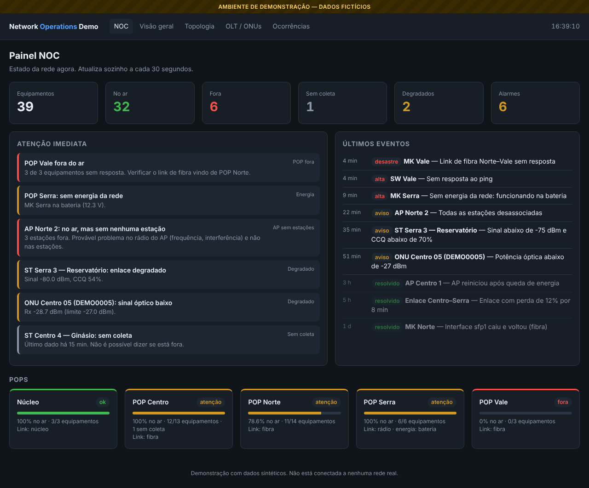
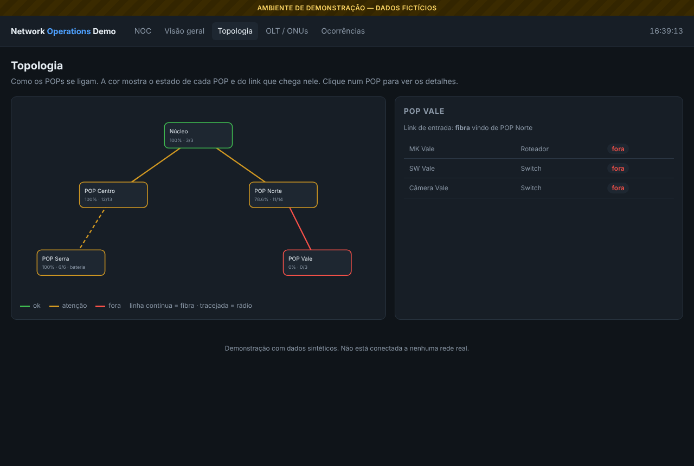
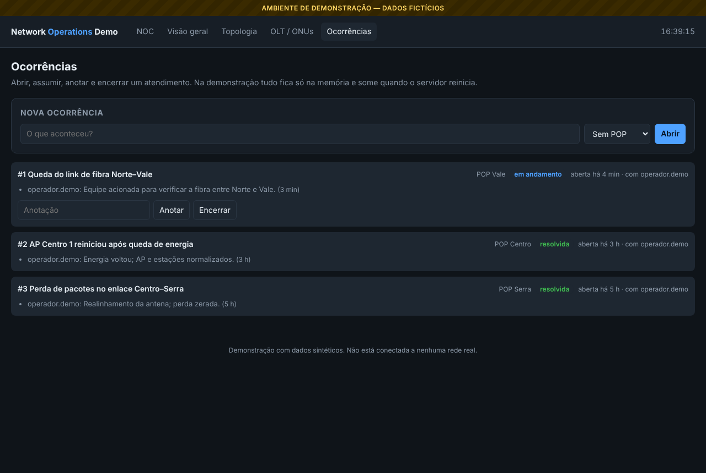
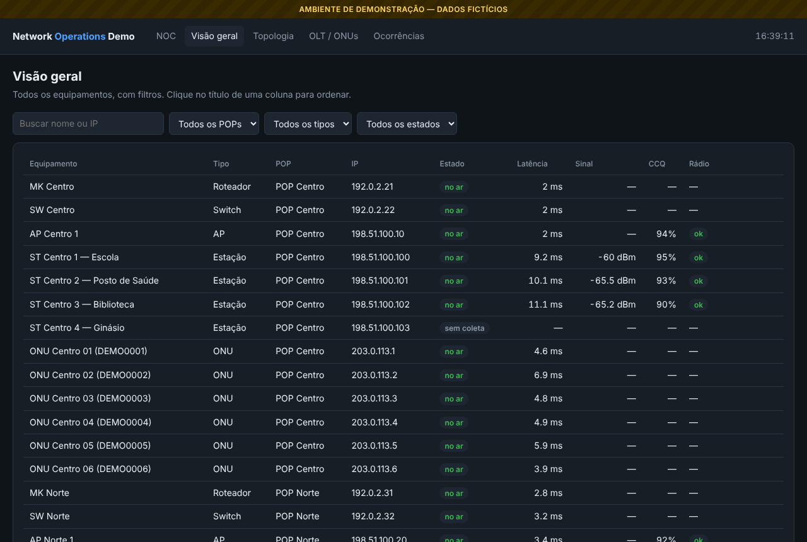
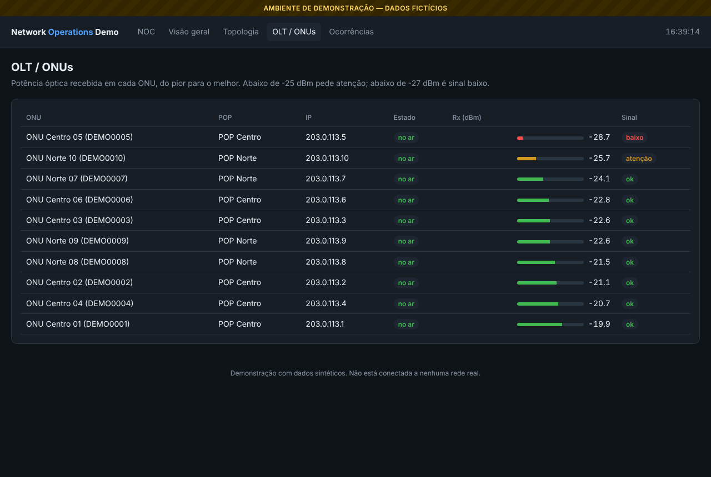

# Network Operations Demo

Plataforma web de operação de rede (NOC) feita em **Python + FastAPI**. Esta é a edição de
demonstração de um sistema que eu desenvolvo e uso no dia a dia para operar uma rede com
vários POPs interligados por fibra e rádio.

> **Ambiente de demonstração com dados 100% fictícios.** Esta edição não se conecta a nenhuma
> rede, monitoramento ou equipamento real. A integração com o Zabbix existe no sistema original
> e fica em ambiente privado.



## O problema

Numa rede com POPs, rádios, MikroTik, switches e OLT GPON, a informação fica espalhada em
várias telas do monitoramento. Quando um POP cai, aparecem dezenas de alarmes ao mesmo tempo e
fica difícil enxergar a causa.

## O que a plataforma faz

- **Painel NOC:** números do momento, estado de cada POP e um bloco de **Atenção imediata**
  com os alarmes já agrupados pela causa provável.
- **Alarmes agrupados:**
  - POP com 80% ou mais dos equipamentos fora vira **um** alarme, e não um por equipamento;
  - AP no ar com todas as estações fora aponta para o rádio do AP, não para as estações;
  - POP funcionando na bateria (sem energia da rede);
  - enlace de rádio degradado (sinal e CCQ) e ONU com sinal óptico baixo.
- **Fora x sem coleta:** um equipamento sem dado novo aparece como "sem coleta", e não como
  "fora". Isso evita alarme falso.
- **Valores de rádio sem associação** (−96 dBm, CCQ 0%) não são tratados como sinal ruim.
- **Visão geral** com filtros e ordenação, **Topologia** dos POPs, **OLT/ONUs** ordenadas pela
  pior potência óptica e **Ocorrências** (abrir, assumir, anotar e encerrar).

## Telas

| Topologia | Ocorrências |
| --- | --- |
|  |  |

| Visão geral | OLT / ONUs |
| --- | --- |
|  |  |

## Como rodar

Precisa de Python 3.10 ou mais novo.

```bash
python -m venv .venv
# Windows: .venv\Scripts\activate    Linux/macOS: source .venv/bin/activate
pip install -r requirements.txt
uvicorn app.main:app --reload
```

Abra <http://127.0.0.1:8000>. A documentação da API fica em <http://127.0.0.1:8000/docs>.

Testes:

```bash
python -m unittest discover -s tests -t .
```

Com Docker:

```bash
docker build -t network-operations-demo .
docker run --rm -p 8000:8000 network-operations-demo
```

## Arquitetura

```
fonte de dados  ──►  regras (funções puras)  ──►  API FastAPI  ──►  páginas HTML/JS
(DATA_SOURCE)        classificação, alarmes,       /api/noc ...      NOC, visão geral,
 demo | real         ONU, energia, POPs                              topologia, OLT
```

- `app/models.py` — contrato de dados comum (POP, equipamento, evento, ocorrência).
- `app/demo_data.py` — rede inventada, com cenários de falha montados de propósito.
- `app/sources.py` — escolhe a fonte por `DATA_SOURCE`. Nesta edição só existe `demo`.
- `app/rules.py` — as regras de operação. Não dependem da fonte e têm testes.
- `app/incidents.py` — ocorrências em memória.
- `app/main.py` — rotas da API e das páginas.

Mais detalhes em [docs/arquitetura.md](docs/arquitetura.md) e
[docs/seguranca-demo.md](docs/seguranca-demo.md).

## Tecnologias

Python · FastAPI · Uvicorn · Pydantic · HTML/CSS/JavaScript (sem framework) · unittest

## Limitações

- Dados sintéticos; nenhuma ação é enviada a equipamentos ou ao monitoramento.
- As ocorrências ficam em memória e somem quando o servidor reinicia.
- Sem login nesta edição (o sistema original tem usuários, permissões por tela e auditoria).

## Autor

Flávio Araújo — Analista de Redes e Infraestrutura ·
[LinkedIn](https://www.linkedin.com/in/flavio51)
